# Meridian Trust Bank — Customer Retention Project, Explained Simply

**Predict. Prioritise. Retain.**

This document explains the whole project in plain language, with the charts, so anyone can follow
what we did and why — no data-science background needed. Every number here comes from the project's
own code output (not typed by hand).

---

## 1. What problem are we solving?

Meridian Trust Bank (a UAE retail bank) is losing customers — this is called **churn**. When a
customer leaves, the bank loses the money they kept in their accounts.

We have records for **10,000 customers**. Of those, **1,578 have already left** — that's a churn
rate of **15.8%**. The balances those leavers held add up to **AED 22.5 million** (about **6.6%** of
all deposits).

The bank's relationship managers can only call so many people. So the real question isn't just
*"who will leave?"* — it's *"which leavers are worth the most money, so we contact them first?"*

**The project does four things:**

1. **Data** — clean the messy raw file and make it trustworthy.
2. **Understanding** — find the patterns: who leaves, and why (as far as the data shows).
3. **Prediction** — build a model that scores each customer's chance of leaving.
4. **Recommendation** — rank customers by *money at risk*, suggest actions, and design a fair test
   (a pilot) to prove those actions work.

> ⚠️ Throughout, we are careful to say a pattern is **associated** with churn, not that it
> **causes** churn. Only a proper experiment (the pilot) can prove cause.

---

## 2. The data (and cleaning it)

The raw file had real-world mess that we fixed with one shared, reusable loader:

- A junk title row at the top, and an empty extra column — removed.
- A summary block pasted below the real customers — removed (we keep only real customer rows).
- Balances stored as text with commas (like `"4,485"`) — converted to real numbers.

We also **checked the data for trust** and found two impossible things. We **flagged** them (marked
them) rather than deleting them, because deleting would throw away ~10% of customers and bias the
results:

- **1,009 customers** whose years-with-the-bank is longer than their life since age 18 (e.g. an
  18-year-old with 10.7 years of tenure) — clearly a data entry error.
- **199 customers** who "hold" fewer products than the product flags say they have.

**Why this matters:** honest data handling is a strength, not a weakness. We never changed the raw
file; everything is reproducible with a fixed random seed.

---

## 3. Making a bigger, privacy-safe dataset (synthetic data)

The dashboard looks better and runs more smoothly with more rows, so we grew the 10,000 real
customers into **50,000** by generating **40,000 synthetic (fake-but-realistic) customers**.

In simple terms: we learned the statistical "shape" of the real customers — how balances, products,
complaints, etc. relate to churn — and then drew new make-believe customers with the same shape. No
synthetic row is a copy of a real person, so it's privacy-safe.

**Did the fakes match the real ones?** Yes, very closely:

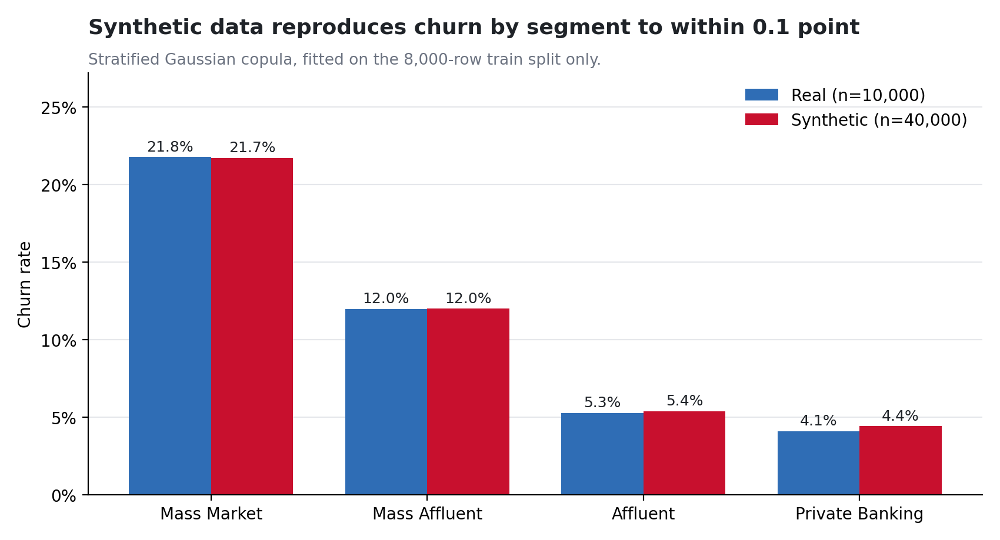

- Real churn rate **15.78%** vs synthetic **15.78%** — identical.
- The biggest difference on any single column was tiny (0.6%).
- Zero synthetic customers were accidental copies of real ones.

> **Honest caveat:** synthetic data adds **volume, not information**. So every headline number and
> the prediction model use the **real 10,000 only**. The fakes are just for the dashboard.

---

## 4. Understanding churn — who leaves, and why?

First we ranked every field by how strongly it relates to churn (a measure called *Cramér's V* —
higher means a stronger link). This tells us which things are worth charting and which to ignore.

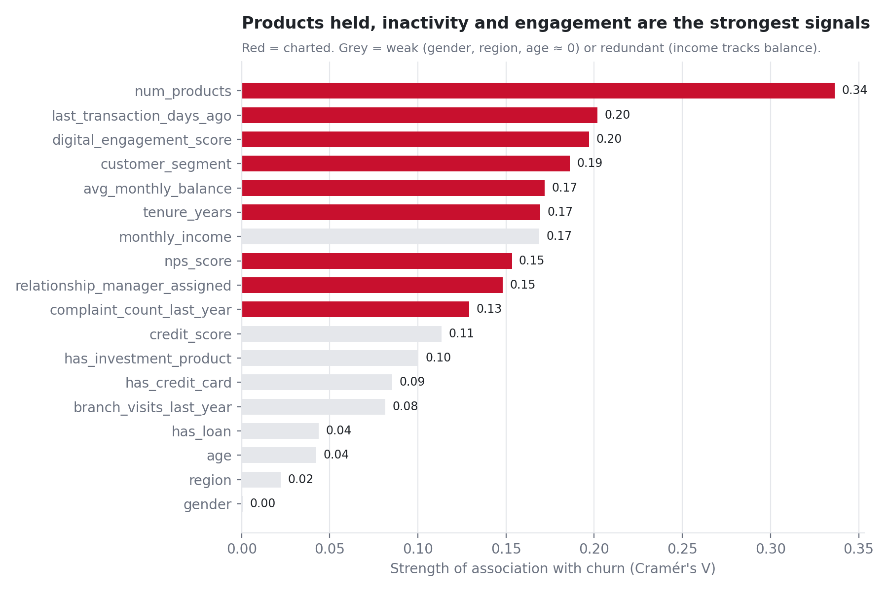

The strongest signals (red bars) are: **number of products held, how long since the last
transaction, digital engagement, customer segment, and balance**. Weak things like gender, region
and age (grey, near zero) are **deliberately ignored** — they carry no useful signal.

Here are the clear patterns. Every bar shows a **confidence interval** (the little whiskers = how
sure we are) and the group size, and a dashed line marks the bank's 15.8% average.

### Customers with only one product leave much more

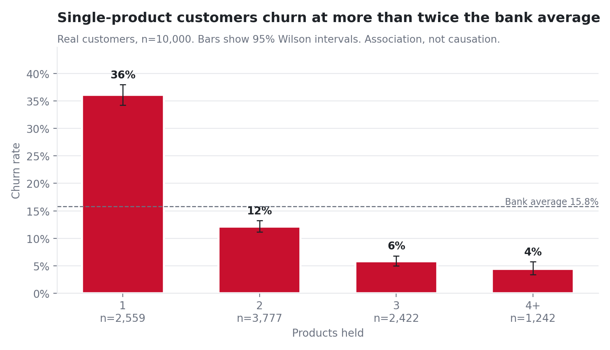

Single-product customers churn at **36%** — three times the rate of two-product customers (**12%**).
The more a customer uses the bank, the more they stay.

### Going quiet is a warning sign

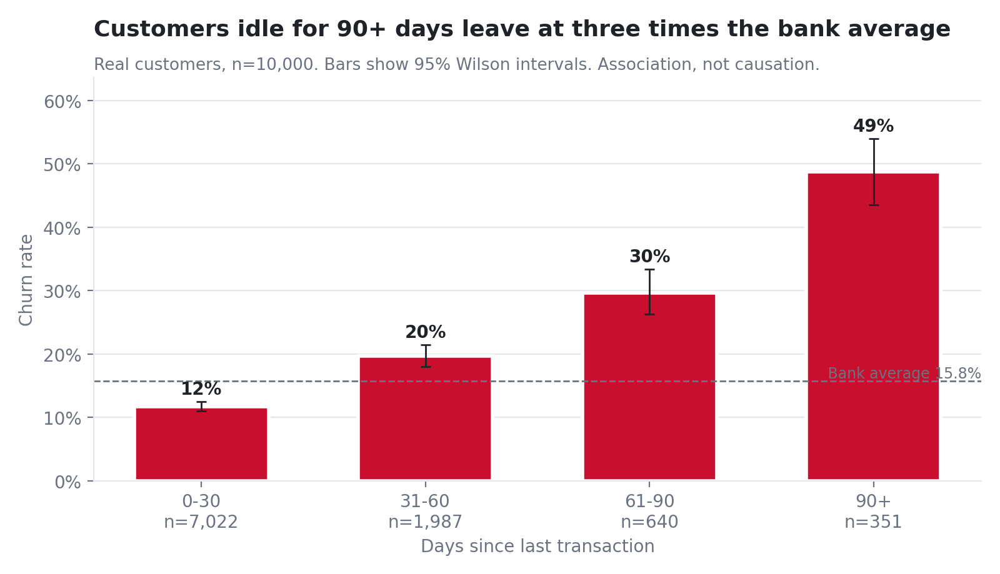

Customers with **no transaction for 90+ days** churn at **49%** — more than triple the average.
Inactivity is one of the loudest alarms.

### Low digital engagement = higher churn

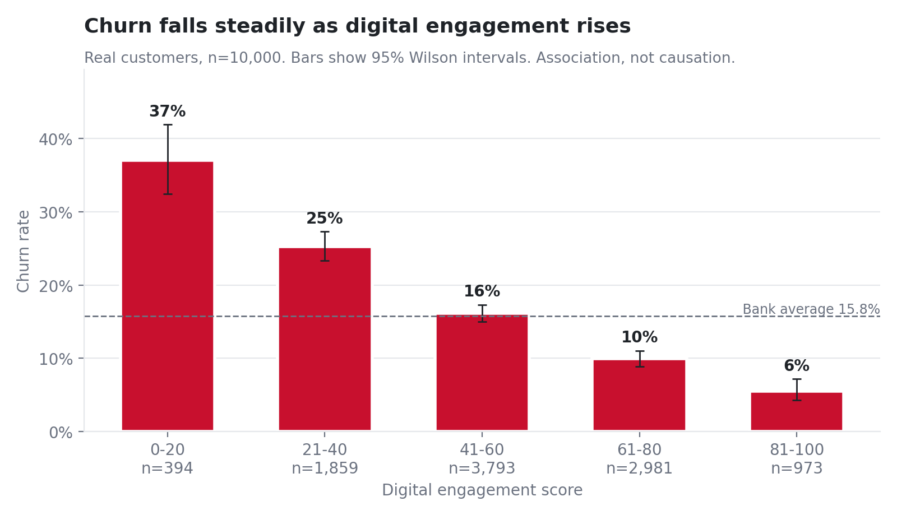

Churn drops steadily from **37%** (least engaged) down to **6%** (most engaged). Engaged customers
stay.

### Complaints matter

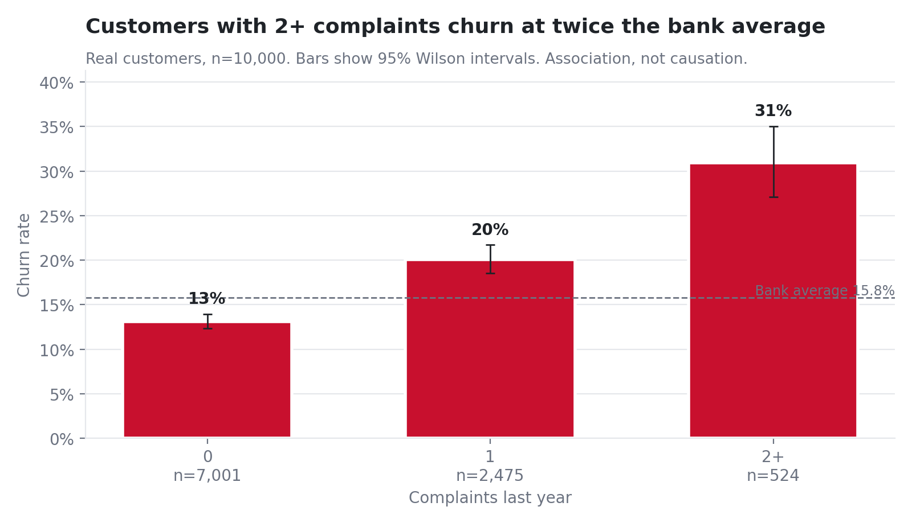

Customers with **2+ complaints** churn at **31%** — about double those with none. Unresolved
frustration pushes people out.

### Unhappy customers (low NPS) leave more

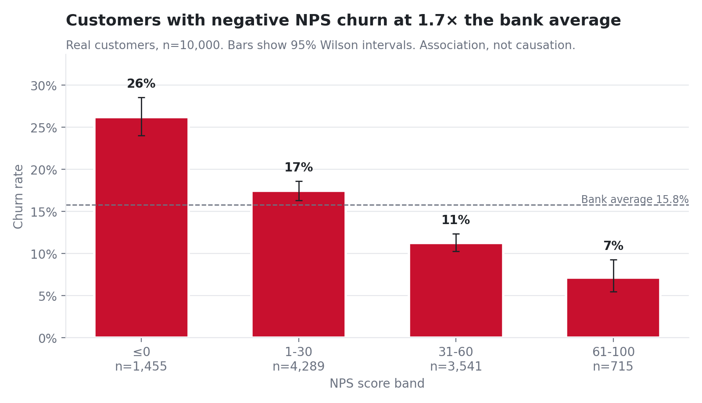

Customers who score the bank negatively churn far more than happy ones (26% vs 7%).

### The danger zone: new AND single-product

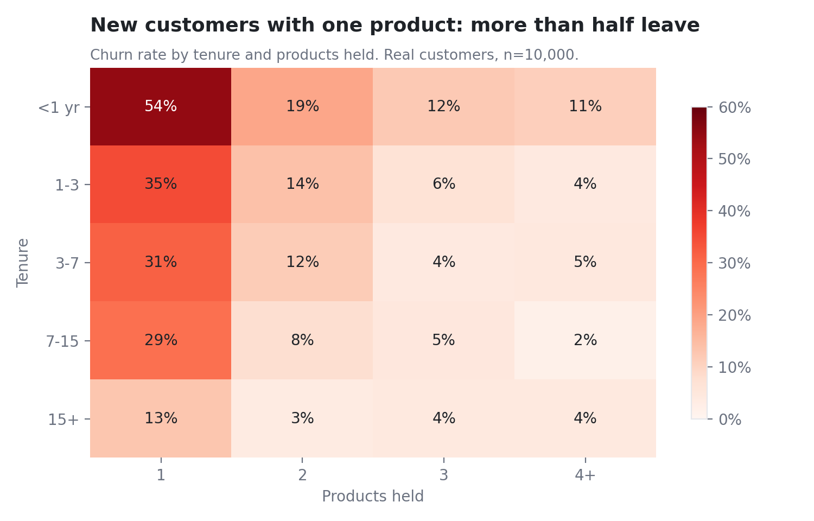

Combining two signals makes it stark: **new customers with just one product — more than half leave**
in the first year. The first year with one product is the make-or-break moment.

### Volume vs value — the key business insight

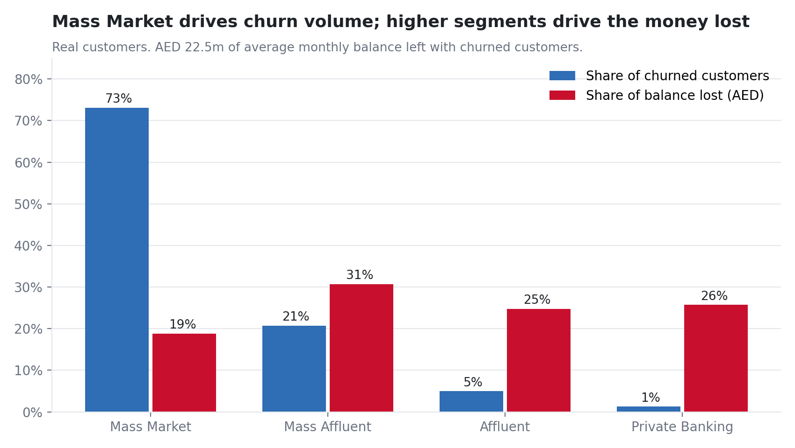

This is the most important chart for the bank. **Mass Market** customers are **73%** of all leavers
(the volume problem), but the **Affluent and Private Banking** segments hold **50%** of the money
that walks out the door (the value problem). *A few high-value leavers can cost more than many
low-value ones.* This is exactly why we rank by **money at risk**, not just probability.

### Relationship managers seem to help

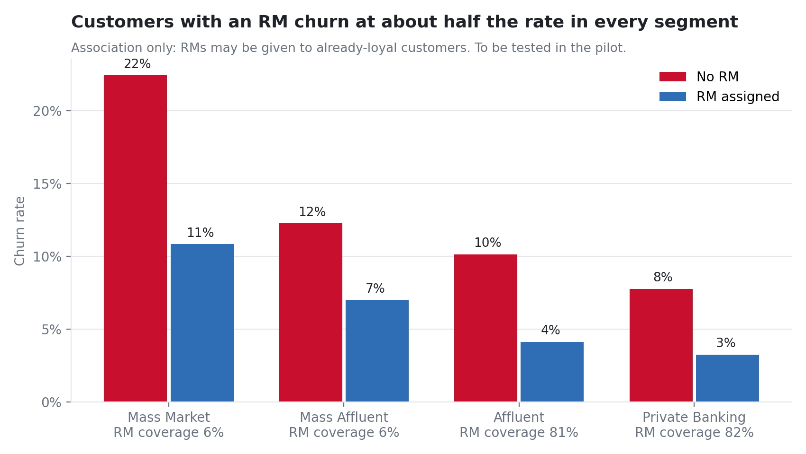

Customers with a relationship manager churn at about **half** the rate in every segment. But careful:
RMs might just be given to already-loyal customers — so this is a **hypothesis to test in the pilot**,
not proof.

---

## 5. Prediction — a model that scores churn risk

We trained a machine-learning model on the real customers to estimate each one's **probability of
leaving**. We compared three options and picked the best on a fair test:

- A simple rule ("new customers will churn") — the weak baseline.
- **Logistic regression** — a transparent, explainable model. **← this one won.**
- LightGBM — a more complex model that didn't do better here.

**How we tested it fairly:** we hid 20% of customers from the model during training (a "holdout"),
then scored them once at the end — so the results reflect genuinely unseen people.

### How good is it?

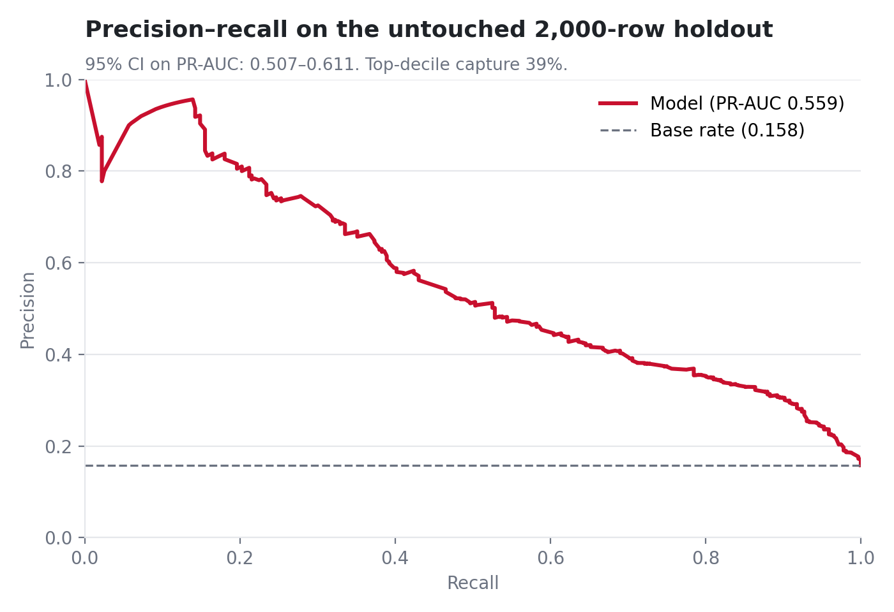

- **PR-AUC = 0.559** (95% confidence 0.51–0.61), versus just **0.158** for guessing at the base
  rate. Much better than chance.
- **ROC-AUC = 0.844** — strong ranking ability.
- The model's **top 10% riskiest customers contain 39% of all actual leavers** — so a small, focused
  list catches a big share of churn.

### We made the probabilities honest ("calibration")

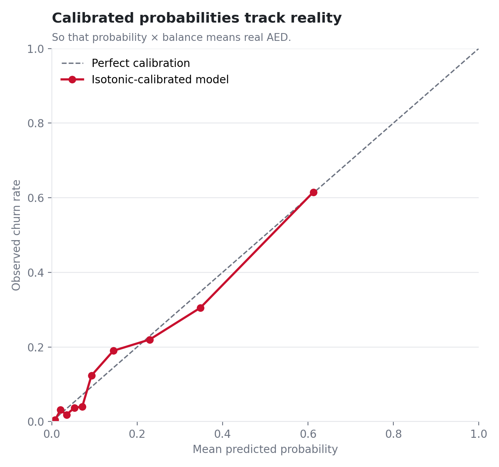

A predicted "30% chance" should mean 30 out of 100 such customers actually leave. This chart shows
our probabilities line up with reality — which matters because we multiply probability × balance to
get money, and that only makes sense if the probability is trustworthy.

### What drives the model's decisions?

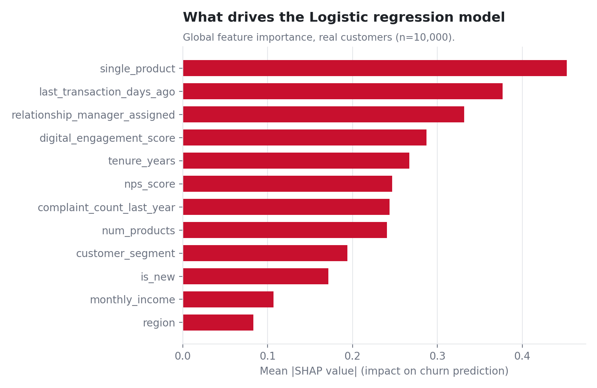

The model relies most on the same human-sensible signals the charts showed: recency, products,
engagement, complaints, tenure. For **each** customer it also produces a plain-English reason like
*"New customer (<1 yr); Single product only; Inactive 60+ days"* — so a relationship manager knows
what to talk about.

> **One honesty note:** "days since last transaction" might partly be a *result* of leaving, not a
> cause. We tested the model with and without it; removing it dropped performance by 0.06, so we
> kept it and documented the caveat.

---

## 6. Prioritisation — who to save first

We combine two things for every customer:

- **Risk:** their calibrated churn probability (high risk = 40% or more).
- **Value:** their balance (high value = top 25%, i.e. ≥ AED 26,867).

That gives four action tiers:

| Tier | Meaning | Who | Customers |
|---|---|---|---|
| **T1 Save now** | High risk + high value | the priority queue | 48 |
| **T2 Protect** | Low risk + high value | guard the relationship | 2,452 |
| **T3 Automated save** | High risk + low value | cheap digital journeys | 972 |
| **T4 Monitor** | Low risk + low value | watch only | 6,528 |

### Why "money at risk" beats "probability alone"

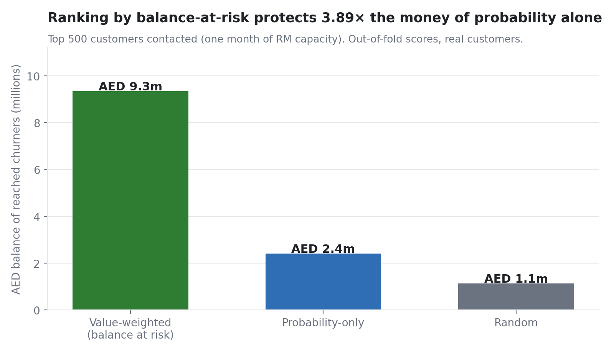

This proves the whole point of the project. Relationship managers can contact about **500 customers
a month**. If they pick those 500 by:

- **Money at risk** (probability × balance): they protect **AED 9.3 million** of churning balances.
- **Probability only:** just **AED 2.4 million**.
- **Random:** only **AED 1.1 million**.

**Same effort — nearly 4× more money protected** simply by ranking the smart way.

Every one of the 10,000 customers gets a row in `out/B/priority_list.csv` with their probability,
balance, money-at-risk, tier, and top-3 reasons.

---

## 7. Recommendation — what to do, and how we'll prove it works

**The playbook** maps each warning sign to an action:

- New / disengaged → a 90-day onboarding journey.
- Complaints → priority resolution + a call from an RM.
- High balance, no RM → assign an RM or upgrade to priority banking.
- Single product → a cross-sell bundle.
- Dormant → a reactivation offer.

**The pilot (an experiment to prove cause).** We don't claim these actions *will* work — we propose
to test them properly with a **randomised controlled trial**: half the high-risk customers get the
treatment, half don't (the control group), and we compare. A statistics calculation says we need
**564 customers per group** to detect a drop from 40% to 32% churn. We only scale actions that both
reduce churn significantly **and** make money (ROI > 1).

---

## 8. Responsible and fair

- **Gender is excluded from the model** and only used to check fairness. We report accuracy by
  gender and age band to catch bias.
- The model is for **outreach only** — never credit, pricing, or who's allowed an account.
- We never dress up correlation as causation.
- The data has **no** competitor-rate, special-offer, or reason-for-leaving fields, so we never
  claim findings about those — they're left as pilot hypotheses.

---

## 9. What was actually built

| Piece | What it is | Where |
|---|---|---|
| Clean data + 50k synthetic | Trustworthy dataset with lineage flags | `out/A/` |
| 9 EDA charts + findings | The patterns above | `out/C/figures/`, `out/C/eda_findings.json` |
| Prediction model | Trained, calibrated, explained, with the priority list | `out/B/` |
| Management report | 1,000–1,500 word write-up for the committee | `out/C/management_report.md` |
| Slide deck | 7 main slides + methodology appendix | `out/C/Meridian_Retention.pptx` |
| Power BI dashboard | 5-page interactive dashboard (project file) | `out/A/powerbi/` |
| Web dashboard | FastAPI + React app for live scoring | `app/` (run `start.bat`) |

### The four stages, one more time

```
   DATA            UNDERSTANDING         PREDICTION          RECOMMENDATION
 clean + check  →  find the patterns  →  score each      →  rank by money,
 50k synthetic     (9 charts, CIs)       customer           act, test with
 flag problems                           (calibrated)       a fair pilot
```

That's the whole project: **clean the data, understand why customers leave, predict who's next, and
focus the bank's limited effort on the customers who are worth the most money — then prove the plan
works with a fair experiment.**

---

*All figures generated from code (seed 42) and reproducible. Technical detail lives in
`out/A/approach_A.md`, `out/B/approach_B.md`, `out/C/approach_C.md`, `out/B/model_card.md`, and
`app/MODEL.md`.*
