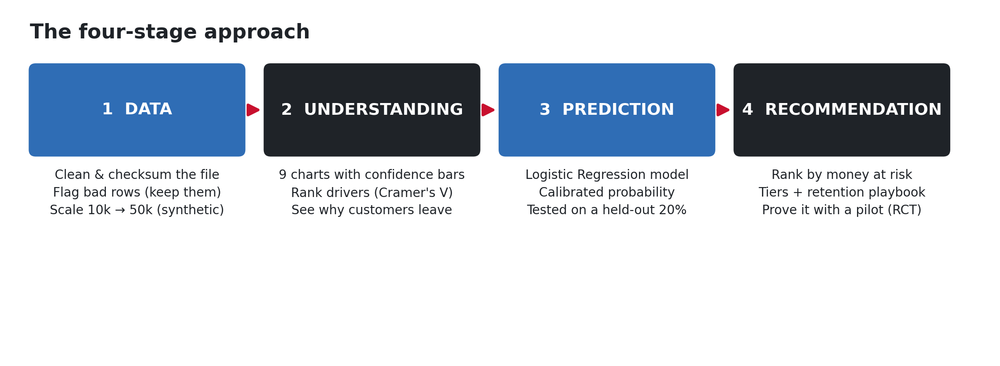

# 3. The approach

The whole project follows **four simple stages**. Each one feeds the next.

### Stage 1 — DATA: make the information trustworthy
We take the messy raw file, clean it, and double-check it matches the bank's own summary numbers.
We also **flag** (but keep) rows that look impossible, and we grow the dataset to 50,000 rows for
the dashboard. *Full details:* [page 4](04_data_and_synthetic.md).

### Stage 2 — UNDERSTANDING: find out why customers leave
We measure how strongly each piece of information is linked to churn, then draw 9 charts that show
the clearest patterns — each with a "margin of error" bar so we don't over-read small groups.
*Full details:* [page 5](05_graphs_explained.md).

### Stage 3 — PREDICTION: score who will leave
We train a model on the real customers to estimate each one's **chance of leaving** (as a
percentage). We test it fairly on customers it never saw, and we make the percentages honest
("calibration"). *Full details:* [page 6](06_model.md).

### Stage 4 — RECOMMENDATION: act on it
We rank customers by the **money at risk**, sort them into four action tiers, suggest a specific
action for each, and design a fair experiment (a pilot) to prove the actions actually work.
*Full details:* [page 7](07_retention.md).

---

## Why this order matters

Each stage only makes sense **after** the one before it:

- You can't trust the patterns (Stage 2) until the data is clean (Stage 1).
- You shouldn't predict (Stage 3) until you understand the patterns (Stage 2).
- You shouldn't act (Stage 4) until you can predict *and* rank by value (Stage 3).

## A note on how the work was split

This was originally a **2-hour team sprint with three people** working in parallel:

- **Person A** = Data (Stage 1)
- **Person B** = Model & prioritisation (Stages 3–4 scoring)
- **Person C** = Understanding & strategy (Stages 2 & 4 recommendations)

They worked independently and only joined up at the end, using a shared file "contract" (agreed file
names and columns) so everything fit together. That's why the results live in `out/A`, `out/B`,
`out/C` — one folder per person.

## The golden rules we followed everywhere

- **No hand-typed numbers** — every figure comes from code output.
- **Never call a correlation a cause** — only the pilot (an experiment) can prove cause.
- **Flag, don't delete** — keep imperfect rows but mark them, so we don't bias the results.
- **Same random seed (42)** — so anyone re-running the code gets the exact same numbers.

➡️ Next: [Data & synthetic data](04_data_and_synthetic.md)
