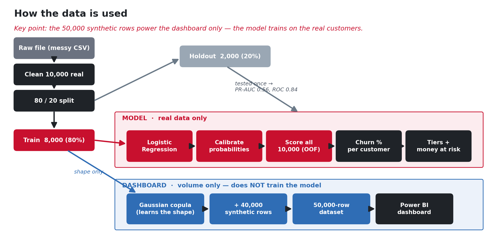
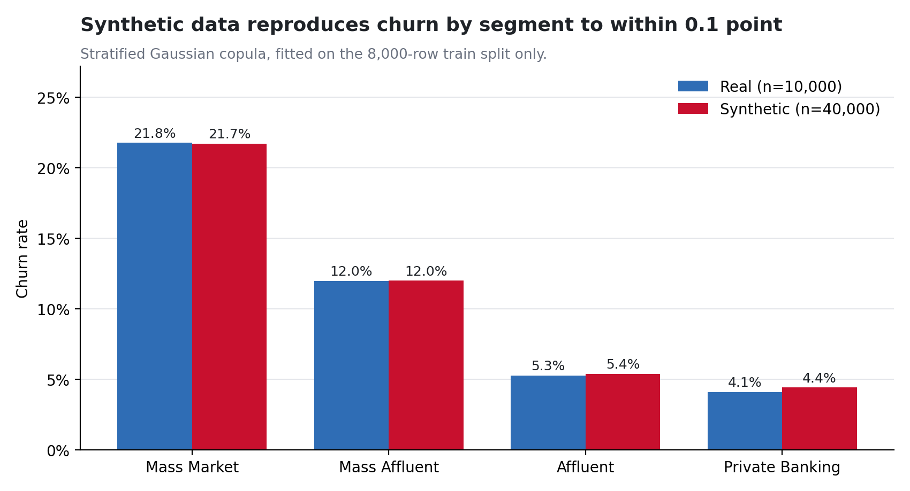

# 4. Data & synthetic data

## Cleaning the raw file (in simple words)

The bank's file came with real-world mess. One shared piece of code fixes it the same way every
time, so we never touch the original file:

- A **junk title row** at the top and an **empty extra column** — removed.
- A **summary block** pasted under the real customers — removed (we keep only real customer rows).
- **Balances stored as text** with commas like `"4,485"` — turned into real numbers.
- We **checked** the cleaned data against the bank's own summary (row counts and churn per
  tenure band) — it matched exactly, so we know nothing was lost.

### Two "impossible" things — flagged, not deleted
While checking, we found two kinds of error. We **kept** these rows but **marked** them, because
deleting them would throw away ~10% of customers and twist the results:

- **1,009 customers** whose years-with-the-bank is longer than their life since age 18 (e.g. an
  18-year-old shown with 10.7 years of tenure).
- **199 customers** who "hold" fewer products than their product flags claim.

Result: a clean file of **10,000 customers** (`out/A/clean_real.csv`), **1,578 of whom churned
(15.8%)**.

---

## ⭐ The most important point: how the 50,000 rows are used

This is the thing people most often get wrong, so here it is clearly:

**The 50,000 rows do NOT train the model.** Here's what actually happens:

1. We start with the **10,000 real customers**.
2. We split them: **8,000 for training**, **2,000 held back** for a fair final test.
3. From the **8,000 training customers**, we generate **40,000 synthetic (fake-but-realistic)**
   customers, giving a **50,000-row dataset**.
4. **The 50,000 rows go to the Power BI dashboard only** — they just make it look fuller and run
   smoothly. They add **volume, not new information**.
5. **The model is trained on the real 8,000**, and every real customer's churn % comes from the
   real data (never from the fakes).

> **In one line:** real customers train the model and produce every headline number; the synthetic
> rows are decoration for the dashboard.

### Why make fakes at all?
Two reasons: (1) a bigger dataset makes the dashboard feel realistic without exposing more real
people, and (2) it demonstrates a **privacy-safe** way to share data — no fake row is a copy of a
real person.

### How the fakes are made (simple version)
We use a method called a **Gaussian copula** (see the [glossary](09_glossary.md)). In plain words:
it learns the *shape* of the real data — how balance, products, complaints, etc. tend to go together
and relate to churn — and then draws new customers with that same shape. It does this **separately
for each customer segment**, so the mix stays correct.

### Did the fakes match the real customers? Yes.

- Real churn rate **15.78%** vs synthetic **15.78%** — identical.
- The biggest gap on any single field was tiny (about 0.6%).
- **Zero** synthetic customers were accidental copies of real ones.
- Every synthetic value stayed inside the real range (no 2.7 products, no impossible credit scores).

> **Honest caveat (we say this everywhere):** synthetic data adds **volume, not information**. So all
> headline figures and the model use the **real 10,000 only**.

➡️ Next: [Every graph explained](05_graphs_explained.md)
