# 5. Every graph explained (in simple words)

This page walks through **all 14 charts**. For each: what you're looking at, and what it tells us.
Any **bold technical term** is explained on the [Glossary page](09_glossary.md).

### How to read the analysis charts first

Most of the churn charts share the same design, so once you can read one you can read them all:

- **Height of the red bar = churn rate** (the share of that group who left).
- The **thin whisker** on top of each bar is the **confidence interval** — a "margin of error". A
  wide whisker means the group is small, so be careful not to over-trust it.
- **n = …** under each bar is the **number of customers** in that group.
- The **grey dashed line** is the bank's overall average churn (**15.8%**), so you can instantly see
  who is above or below average.
- Colours carry meaning everywhere: **red = churn / money lost**, **blue = comparison**.

---

## Part A — Why customers leave (the 9 analysis charts)

### Chart 1 — Driver ranking (which things matter)
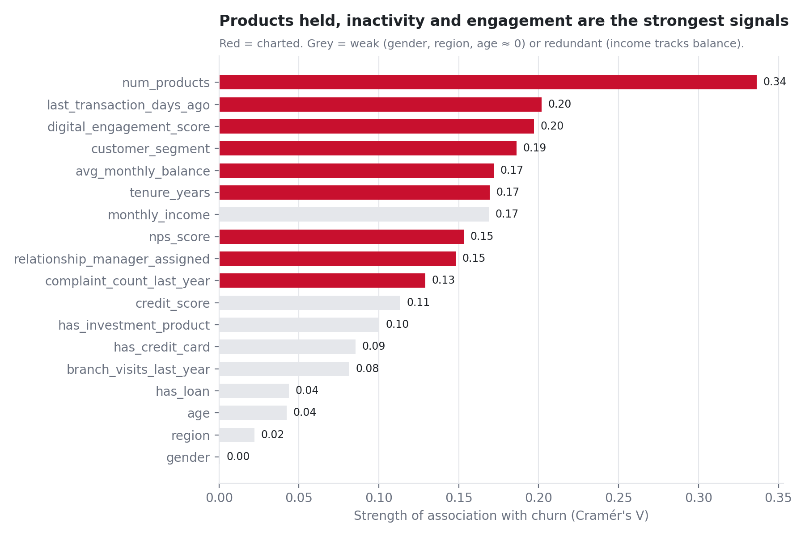

**What it is:** every field scored by how strongly it relates to churn, using **Cramér's V** (0 = no
link, 1 = perfect link). **What it says:** the top signals (red) are *number of products, days since
last transaction, digital engagement, segment, and balance*. Weak ones (grey) like gender, region
and age are near zero — so we **ignore** them. This chart justifies which other charts we bother to
draw.

### Chart 2 — Products held
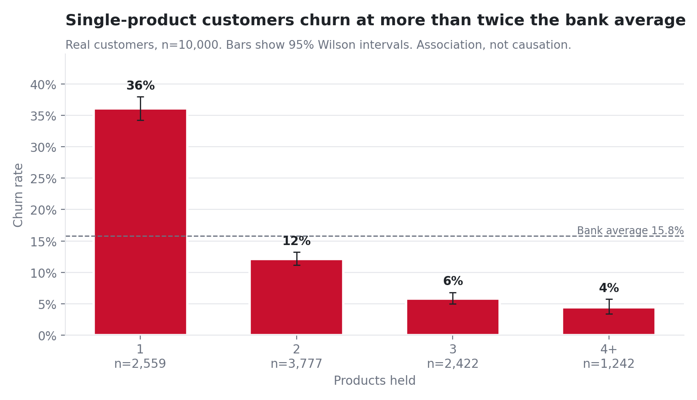

**What it says:** customers with **one product churn at 36%** — about **three times** the rate of
two-product customers (**12%**). The more a customer uses the bank, the stickier they are.

### Chart 3 — Days since last transaction ("recency")
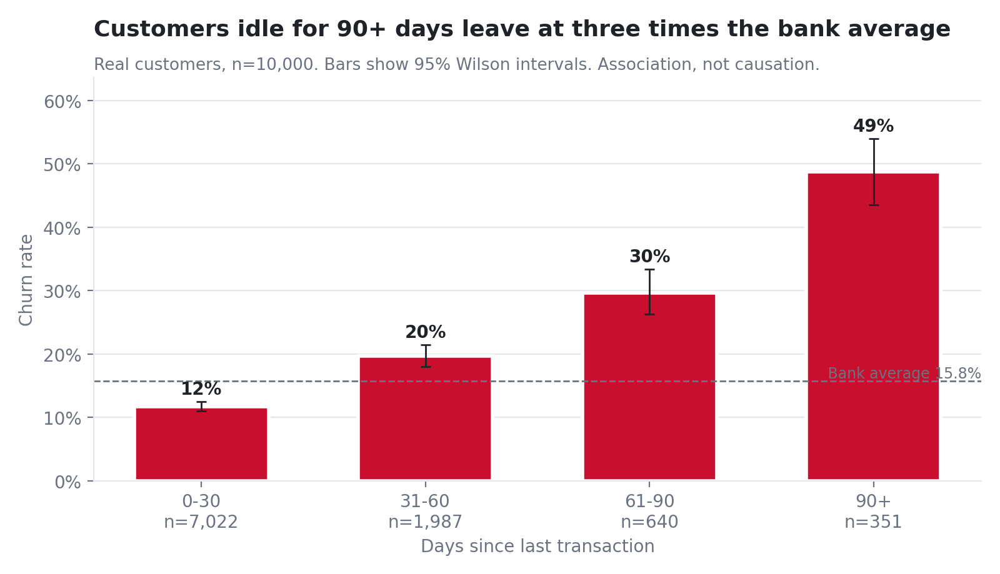

**What it says:** going quiet is a loud warning. Customers with **no activity for 90+ days churn at
49%** — more than triple the average. Recent inactivity is one of the strongest alarms.

### Chart 4 — Digital engagement
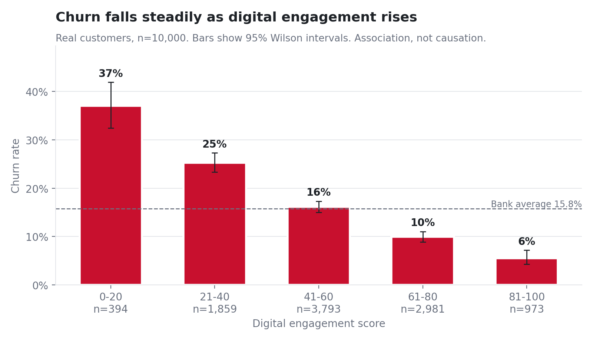

**What it says:** churn falls steadily as app/online use rises — from **37%** (least engaged) down
to **6%** (most engaged). Engaged customers stay.

### Chart 5 — Complaints
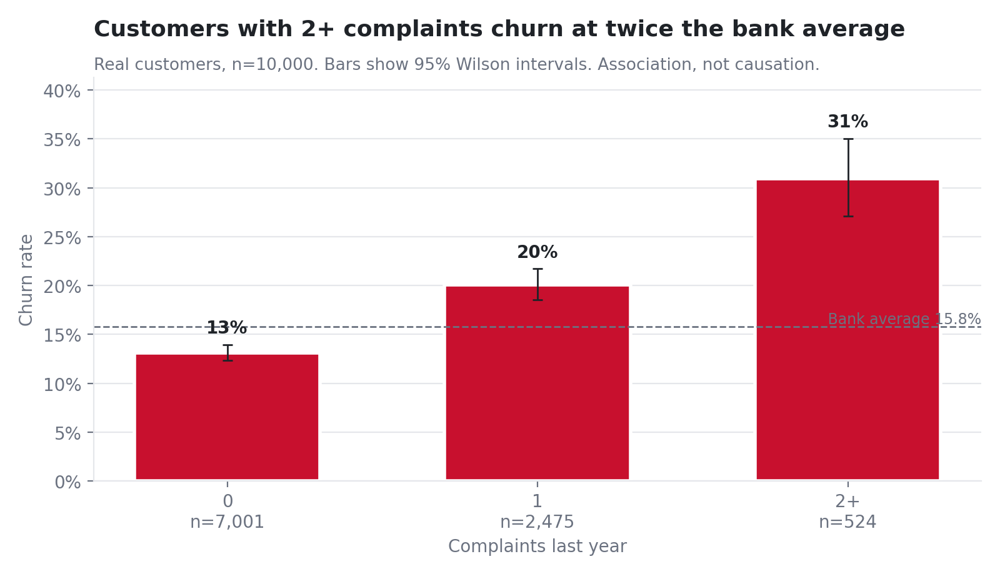

**What it says:** customers with **2+ complaints churn at 31%**, about double those with none (13%).
Unresolved frustration pushes people out.

### Chart 6 — NPS (how happy they are)
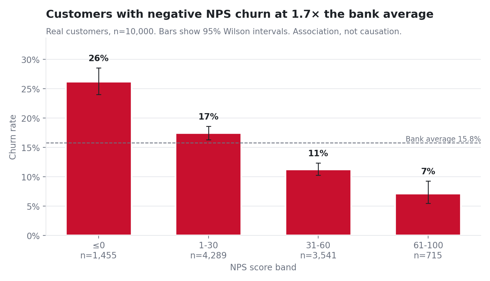

**What it is:** **NPS** is a satisfaction score from −100 to +100. **What it says:** unhappy
customers (negative score) churn at **26%** versus **7%** for the happiest. Dissatisfaction leads to
leaving.

### Chart 7 — Tenure × products (a heatmap)
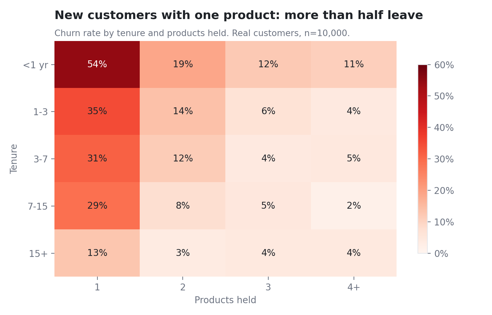

**What it is:** a grid coloured by churn rate — rows are how long they've banked with us, columns are
how many products they hold; **darker red = more churn**. **What it says:** the worst corner is
**new customers with only one product — more than half leave** in the first year. Two warning signs
together are far worse than one.

### Chart 8 — Volume vs value (the key business chart)
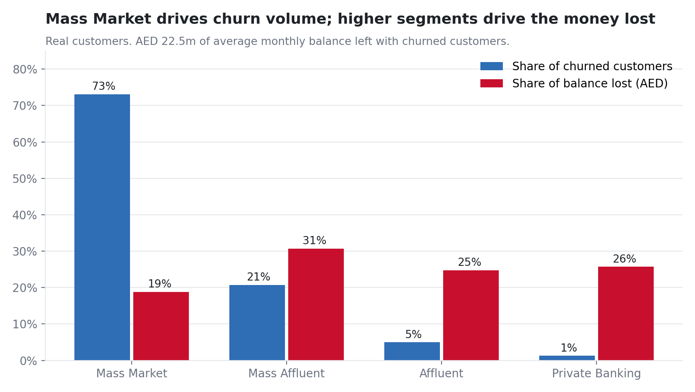

**What it is:** for each customer segment, blue = share of all *leavers*, red = share of all *money*
that left. **What it says:** **Mass Market** customers are **73%** of leavers (a *volume* problem),
but the **Affluent + Private Banking** segments hold **50%** of the lost money (a *value* problem).
**This is exactly why we rank by money at risk, not just by who is likely to leave.**

### Chart 9 — Relationship managers (RMs)
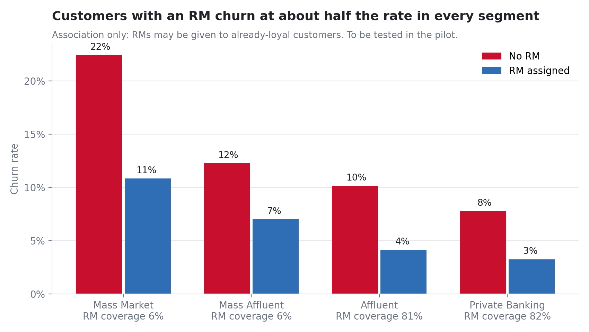

**What it says:** customers with a personal **relationship manager** churn at about **half** the rate
in every segment. **But be careful:** RMs may simply be given to already-loyal customers — so this
is a **hypothesis to test in the pilot**, not proof that RMs cause loyalty.

---

## Part B — The model charts (4)

### Chart 10 — Precision–Recall curve (how good the model is)
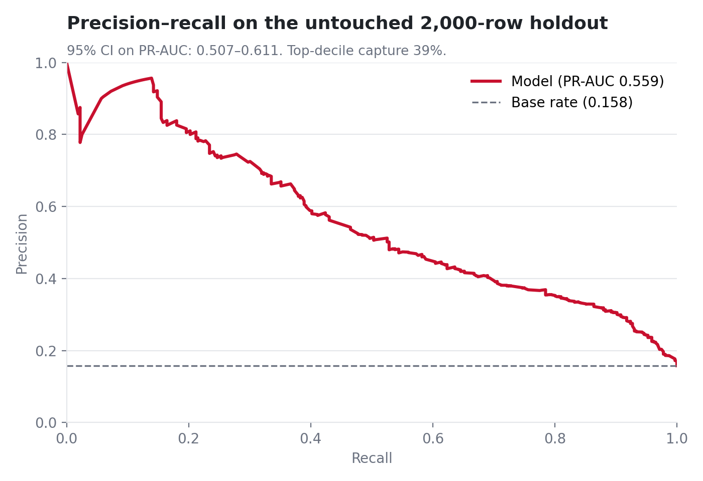

**What it is:** a standard way to measure a model when the thing you're predicting is rare (only
15.8% churn). The single score is **PR-AUC** (higher = better). **What it says:** the model scores
**0.559**, versus **0.158** for guessing — so it's **much better than chance**. (See
[glossary](09_glossary.md) for *precision*, *recall*, *PR-AUC*.)

### Chart 11 — Calibration (are the percentages honest?)
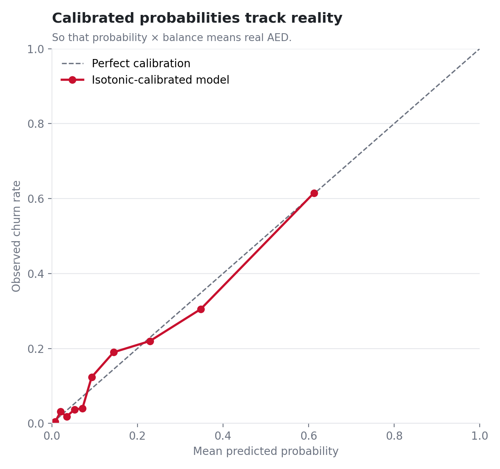

**What it is:** it checks that when the model says "30% chance", about 30 out of 100 such customers
really do leave. The dots should sit on the diagonal line. **What it says:** our probabilities line
up with reality — which matters because we multiply **probability × balance** to get money, and that
only works if the probability is trustworthy.

### Chart 12 — SHAP (what drives the model)
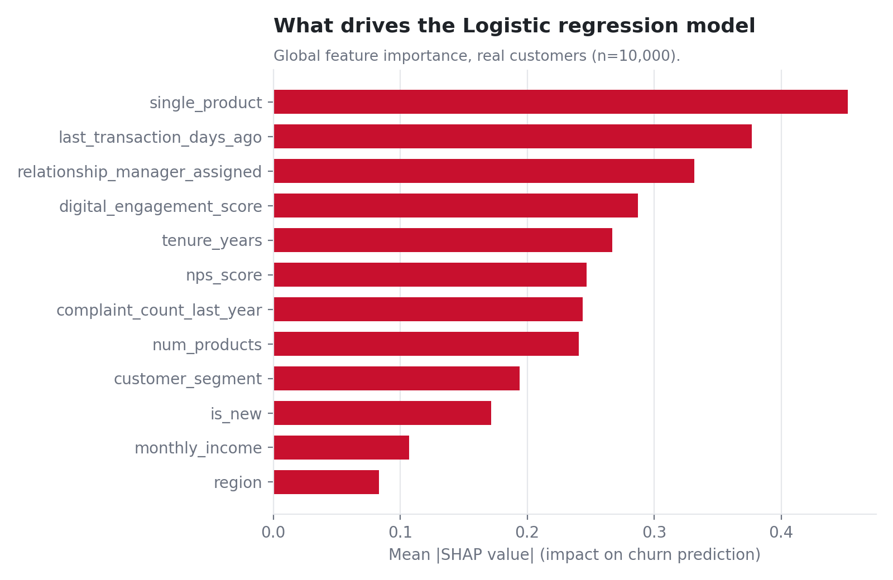

**What it is:** **SHAP** measures how much each piece of information pushes the model's prediction.
**What it says:** the model leans on the same sensible signals the charts showed — recency, products,
engagement, complaints, tenure. The model also gives **each customer** a plain-English reason (e.g.
*"New customer; single product; inactive 60+ days"*).

### Chart 13 — Why "money at risk" beats "probability alone"
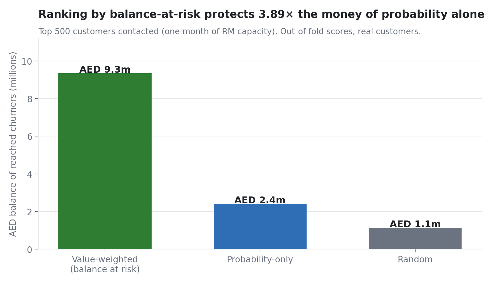

**What it is:** relationship managers can contact about **500 customers a month**. This compares how
much *churning money* those 500 calls protect, depending on how you pick them. **What it says:**
picking by **money at risk** protects **AED 9.3 million**, versus **AED 2.4m** by probability alone
and **AED 1.1m** at random. **Same effort — nearly 4× more money saved.** This is the heart of the
whole project.

---

*(The fake-vs-real chart is on [page 4](04_data_and_synthetic.md).)*

➡️ Next: [The model](06_model.md)
