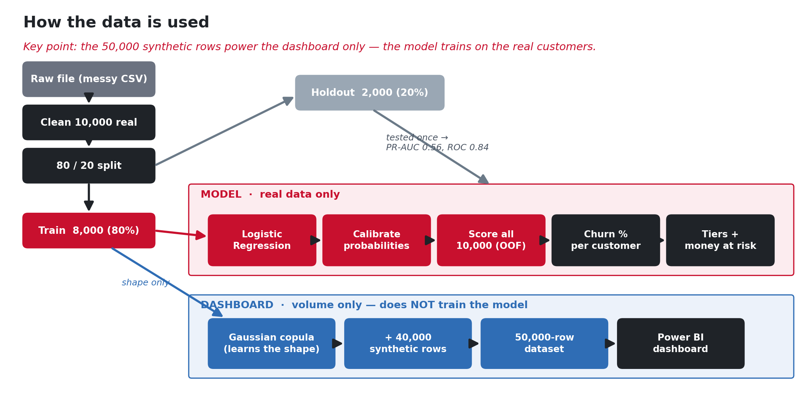

# 6. The model — what, why, and how it predicts

## What model did we use?

**Logistic Regression** — a classic, transparent model that estimates a **probability** (a number
between 0% and 100%) that a customer will leave.

We didn't just pick it blindly. We compared three options and let the data choose:

| Model | What it is | Score (CV PR-AUC) |
|---|---|---|
| Baseline rule | "new customers will churn" — a dumb guess | 0.158 |
| **Logistic Regression** | simple, explainable | **best — chosen** |
| LightGBM | a more complex, powerful model | did not beat Logistic Regression here |

## Why Logistic Regression?

- It **won** on the fair score (**PR-AUC** — see [glossary](09_glossary.md)).
- It's **explainable** — a bank's risk committee can understand and trust it. When two models are
  about equal, the simpler, clearer one is the right choice.
- It produces a clean **probability** that we can turn into money (probability × balance).

## How is it trained, and how does it give a "% prediction"?

1. **Train on the real 8,000 customers** (not the synthetic ones — see
   [page 4](04_data_and_synthetic.md)).
2. **Test once** on the 2,000 customers held back, so the scores reflect genuinely unseen people.
3. **Calibrate** the probabilities so "30%" really means 30-in-100.
4. For every real customer, the model outputs a **churn probability, e.g. 0.73 = a 73% chance of
   leaving**. That *is* the "percent prediction".
5. We then compute **expected balance at risk = probability × their balance** — the money we'd
   expect to lose from that customer.

### Scoring a brand-new customer
The saved model (`out/B/model.joblib`, and the app's `app/backend/artifacts/app_model.joblib`) can
score anyone. In the web app you type in a customer's details and instantly get their **churn %,
tier, money at risk, reasons, and a retention plan** (see [page 7](07_retention.md)). On the command
line, `score.py` does the same for a whole file of new customers.

## How good is it? (results in simple words)

| Measure | Value | What it means in plain words |
|---|---|---|
| **PR-AUC** | **0.559** | Much better than guessing (0.158). The primary score for a rare event. |
| **ROC-AUC** | **0.844** | If you pick one leaver and one stayer, the model ranks them correctly ~84% of the time. |
| **Top-decile capture** | **39%** | The model's riskiest 10% of customers contain 39% of *all* leavers — a short list catches a big chunk. |
| **Recall @ 40%** | **40%** | Of the people who actually left, the model flagged 40% at the "high-risk" line. |
| **Precision @ 40%** | **58%** | Of the people it flagged as high-risk, 58% actually left. |

**Bottom line:** the model is clearly useful — it finds a large share of leavers in a small, focused
list, and its probabilities are honest enough to turn into money.

## Being responsible

- **Gender is left out of the model** and used only to check fairness (we report accuracy by gender
  and age band in `out/B/model_card.md`).
- The model is for **outreach only** — never deciding credit, pricing, or who may hold an account.
- We tested for **leakage** (a sneaky way a model can "cheat"): the "days since last transaction"
  field might partly be a *result* of leaving. Removing it lowered performance by 0.06, so we kept it
  and wrote down the caveat.

> **Note on the two models in this project:** the files in `out/B/` use the full model; the live web
> app uses a **leaner version** that keeps only the most relevant fields (see `app/MODEL.md`). They
> score almost identically (PR-AUC 0.559 vs 0.560), which proves the dropped fields were not needed.

➡️ Next: [How to retain a customer](07_retention.md)
