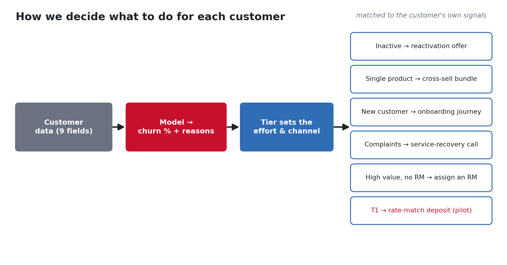
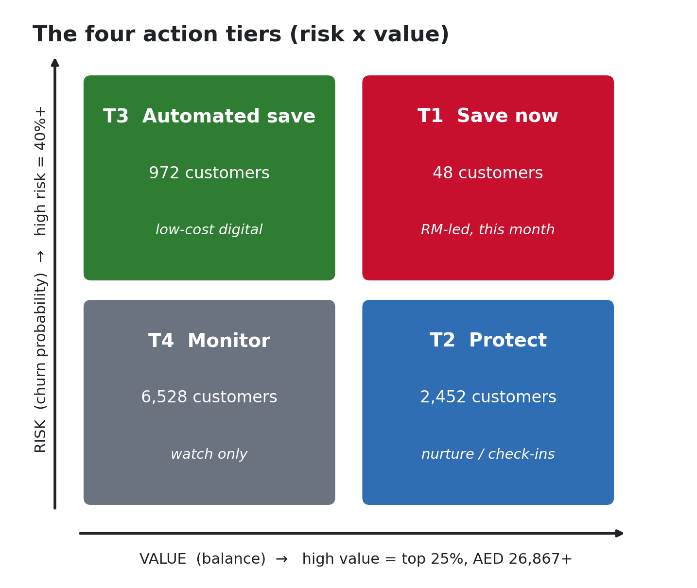

# 7. How to retain a customer — the procedure

This is the "so what do we *do* about it?" page. Once the model predicts a customer's risk, here is
exactly how we decide what to do for them.

## Step 1 — Predict
The model turns the customer's details into a **churn probability** (e.g. 73%) and a short list of
**plain-English reasons** (e.g. *new customer, single product, inactive 60+ days*).

## Step 2 — Put them in a tier (risk × value)
We combine **how likely** they are to leave with **how much money** they hold:

- **High risk** = churn probability of **40% or more**.
- **High value** = balance in the **top 25%** (AED 26,867 or more).

That gives four tiers, each with a different level of effort:

| Tier | Who | What we do | Customers |
|---|---|---|---|
| **T1 Save now** | high risk + high value | hands-on, RM-led rescue **this month** | 48 |
| **T2 Protect** | low risk + high value | keep them happy, periodic check-ins | 2,452 |
| **T3 Automated save** | high risk + low value | cheap, automated digital nudges | 972 |
| **T4 Monitor** | low risk + low value | just watch, no spend | 6,528 |

The tier decides **how much effort and which channel** — a valuable T1 customer gets a personal call;
a low-value T3 customer gets the same idea delivered automatically and cheaply.

## Step 3 — Match actions to the customer's own reasons
Each warning sign maps to a specific action. The web app builds this list automatically for the
exact customer you're looking at:

| If the signal is… | The action is… | Channel | Rough cost |
|---|---|---|---|
| Inactive 60+ days | Reactivation offer (cashback on next transactions) | App push / RM call | ~AED 75 |
| Single product only | Cross-sell a complementary bundle | In-app / RM | ~AED 50 |
| New customer (<1 yr) | 90-day onboarding journey + salary-transfer bonus | RM + email | ~AED 200 |
| Low digital engagement | Guided app activation and nudges | App push + email | ~AED 20 |
| 2+ complaints | Priority resolution + a service-recovery call | RM call | ~AED 120 |
| Negative NPS | Service-recovery conversation + follow-up | RM call | ~AED 100 |
| High balance, no RM | Assign a relationship manager / priority upgrade | RM assignment | ~AED 300 |
| High value + high risk (T1) | *Hypothesis:* rate-match / bonus-profit-rate deposit (incl. Islamic options) | RM | — |

The app also adds up an **estimated cost to retain** that customer, so you can weigh it against the
money at risk.

> ⚠️ These are **recommendations, not guarantees**. We do **not** claim they definitely work — that's
> what the pilot is for.

## Step 4 — Prove it works (the pilot)
Before rolling anything out bank-wide, we run a **randomised controlled trial (RCT)** — a fair
experiment:

- Take the high-risk tiers (T1 and T3).
- **Randomly** give half the treatment and half nothing (the "control" group).
- Compare their churn after 90 and 180 days.
- A sample-size calculation says we need **564 customers per group** to reliably detect a drop from
  40% to 32% churn.
- **Keep what works, drop what doesn't:** only scale an action if it significantly reduces churn
  **and** makes money (ROI > 1).

This is the only honest way to turn "these things are *associated* with staying" into "these actions
*cause* customers to stay".

## Doing this live
Open the web app (run [`../start.bat`](../start.bat)), go to **"Score a customer"**, type in a
customer's details, and you'll instantly see their churn %, tier, money at risk, reasons, and the
**tailored retention plan** with costs. See [page 8](08_dashboards.md).

➡️ Next: [The dashboards](08_dashboards.md)
