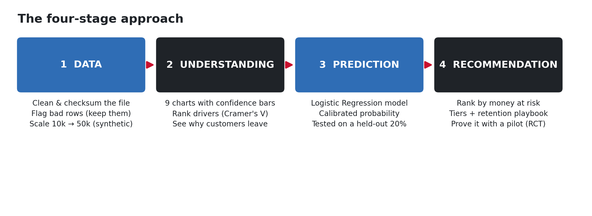

# 📚 Meridian Retention Project — Documentation

Welcome. This folder explains **everything** in the project in plain language, with diagrams and all
the charts. Start here, then read whichever page you need.

Every number in these docs comes from the project's own code output (fixed random seed, so results
are reproducible).

## Presenting this project?

👉 **[Presentation sequence (presenter runbook)](PRESENTATION.md)** — a ~10-minute talk that walks
through these docs in order, with the visual to show and a script for each stop.

## Contents

| # | Page | What it covers |
|---|---|---|
| 1 | [Project goals & how we met them](01_project_goals.md) | The brief, point by point, and where each is answered |
| 2 | [Folder guide](02_folder_guide.md) | What every folder and key file does |
| 3 | [The approach](03_approach.md) | The 4-stage method, with the approach diagram |
| 4 | [Data & synthetic data](04_data_and_synthetic.md) | Cleaning, and **how the 50,000 rows are really used** |
| 5 | [Every graph explained](05_graphs_explained.md) | All 14 charts, in simple words |
| 6 | [The model](06_model.md) | What model, why, and how it gives a % prediction |
| 7 | [How to retain a customer](07_retention.md) | The step-by-step retention procedure |
| 8 | [The dashboards](08_dashboards.md) | Power BI + the FastAPI/React web app |
| 9 | [Glossary](09_glossary.md) | Every complex term, explained simply |

## The project in one sentence

> Meridian Trust Bank is losing customers; this project **cleans the data, finds why customers
> leave, predicts who will leave next, ranks them by the money at risk, and recommends what to do —
> then proves the plan with a fair experiment (a pilot).**

## Quickest tour

- **Just want the story?** Read [`../PROJECT_OVERVIEW.md`](../PROJECT_OVERVIEW.md).
- **Want to run the live dashboard?** Double-click [`../start.bat`](../start.bat) (see
  [page 8](08_dashboards.md)).
- **Want the committee report / slides?** `../out/C/management_report.md` and
  `../out/C/Meridian_Retention.pptx`.
